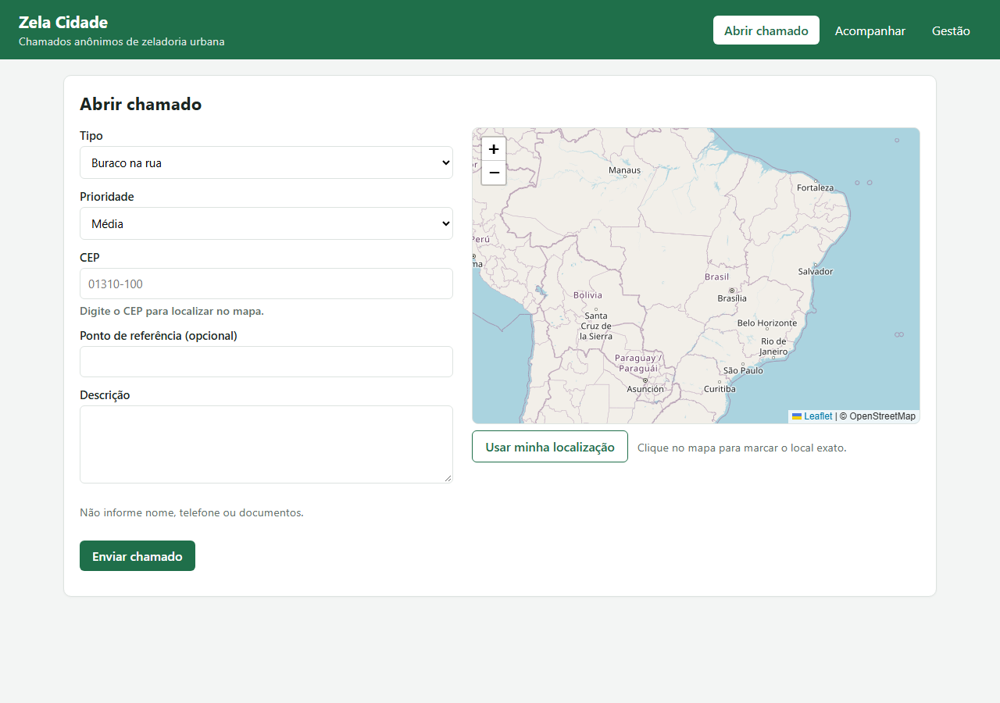
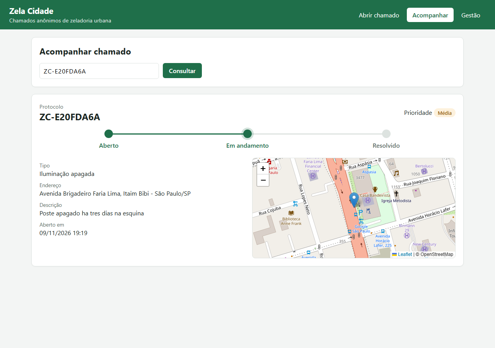
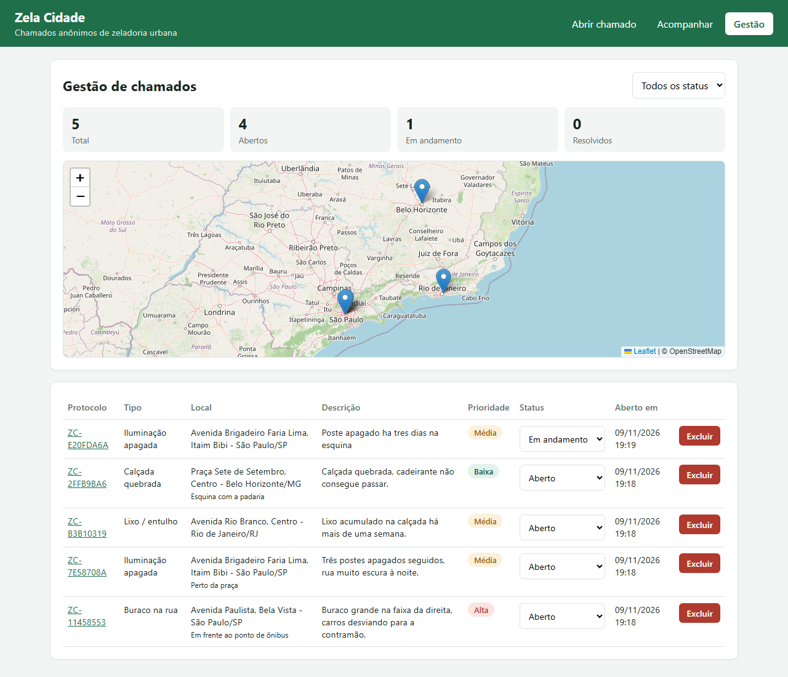

# Zela Cidade

Chamados anônimos de zeladoria urbana (buraco, iluminação, lixo, calçada, árvore).
Global Solution, Coding for Security. Eduardo Castro, turma 1TDCPV.

## Tecnologias

- Flask (API REST), MySQL (SQL puro, sem ORM), ViaCEP (API externa), socket TCP, HTML/CSS/JS.
- Mapa: Leaflet + OpenStreetMap (Nominatim para localizar o endereço).

## Telas

- `index.html`: o cidadão abre o chamado, marca o local no mapa e recebe o protocolo (ex.: `ZC-7F3A9B21`)
- `acompanhar.html`: consulta pelo protocolo, com linha do tempo e mapa
- `gestao.html`: a prefeitura lista, muda o status e exclui chamados, com um mapa de todos





## Estrutura (MVC)

```
app.py                  ponto de entrada
config.py               leitura do .env
modelos/                MySQL, ViaCEP, log e cliente socket
controles/              rotas /api e tratamento de erros
visao/                  tela web
servidor_central.py     servidor TCP que recebe alertas
inicializar_banco.py    cria banco, tabela e dados fictícios
testar_api.py           validação dos endpoints
```

## Como executar

Pré-requisitos: Python 3.11+ e MySQL.

```bash
pip install -r requirements.txt
copy .env.example .env          # ajuste usuário e senha do MySQL
python inicializar_banco.py
python servidor_central.py      # terminal 1 (opcional)
python app.py                   # terminal 2 -> http://127.0.0.1:5000
python testar_api.py            # terminal 3, com a API rodando
```

## Endpoints

| Método | Rota | Retorno |
| --- | --- | --- |
| GET | `/api/chamados` | 200 |
| GET | `/api/chamados/<id>` | 200, 404 |
| GET | `/api/chamados/protocolo/<protocolo>` | 200, 400, 404 |
| GET | `/api/cep/<cep>` | 200, 400, 404, 503 |
| POST | `/api/chamados` | 201, 400, 404, 429, 503 |
| PUT | `/api/chamados/<id>` | 200, 400, 404 |
| DELETE | `/api/chamados/<id>` | 200, 404 |

Exemplo de corpo do POST:

```json
{"tipo": "buraco", "cep": "01310-100", "prioridade": "alta", "descricao": "Buraco grande na faixa da direita",
 "latitude": -23.5614, "longitude": -46.6559}
```

A resposta traz o `protocolo` do chamado. `latitude` e `longitude` são opcionais.
Chamados com prioridade `alta` enviam um alerta TCP para a central.

## Logs

- `logs/app.log`: data/hora, ação e resultado
- `logs/central.log`: alertas recebidos pela central

## Segurança

- Credenciais no `.env`, fora do Git
- Consultas parametrizadas
- Validação de todas as entradas
- Erros sem detalhes internos
- Sem dados pessoais (LGPD)
