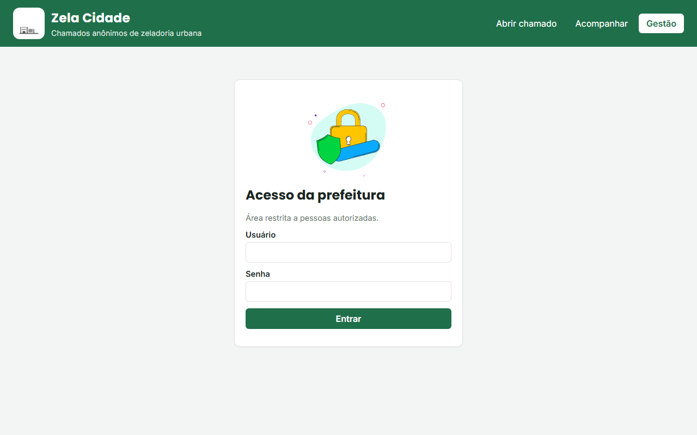

# Zela Cidade

Chamados anônimos de zeladoria urbana (buraco, iluminação, lixo, calçada, árvore).
Global Solution, Coding for Security. Eduardo Castro, RM 573427, turma 1TDCPV.

## Tecnologias

- Flask (API REST), MySQL (SQL puro, sem ORM), ViaCEP (API externa), socket TCP, HTML/CSS/JS.
- Mapa: Leaflet + OpenStreetMap (Nominatim para localizar o endereço).
- Animações: Lottie (`lottie-web`), arquivos em `visao/animacoes/`. Fontes: Poppins e Inter (Google Fonts).

## Telas

- `index.html`: o cidadão abre o chamado, marca o local no mapa e recebe o protocolo (ex.: `ZC-7F3A9B21`)
- `acompanhar.html`: consulta pelo protocolo, com linha do tempo e mapa
- `login.html` → `gestao.html`: a prefeitura (com login) lista, muda o status e exclui chamados




## Estrutura (MVC)

```
app.py                  ponto de entrada
config.py               leitura do .env
modelos/                MySQL (chamados e usuários), ViaCEP, log e cliente socket
controles/              rotas /api, login e tratamento de erros
visao/                  telas web
servidor_central.py     servidor TCP que recebe alertas
inicializar_banco.py    cria banco, tabelas, usuário admin e dados fictícios
criar_usuario.py        cadastra outros usuários da gestão
testar_api.py           validação dos endpoints
```

## Como executar

Pré-requisitos: Python 3.11+ e MySQL.

```bash
pip install -r requirements.txt
copy .env.example .env          # ajuste usuário e senha do MySQL
python inicializar_banco.py
python servidor_central.py      # terminal 1 (opcional)
python app.py                   # terminal 2 -> http://127.0.0.1:5000
python testar_api.py            # terminal 3, com a API rodando
```

## Acesso à gestão

- Endereço: <http://127.0.0.1:5000/login.html>
- Usuário: `admin`
- Senha: `KrGM3dcOScx3`

O usuário vem do `.env` (`ADMIN_USUARIO` e `ADMIN_SENHA`) e é gravado com a senha em hash. Para criar outros usuários, use `python criar_usuario.py`.

## Endpoints

| Método | Rota | Acesso | Retorno |
| --- | --- | --- | --- |
| GET | `/api/chamados` | login | 200, 401 |
| GET | `/api/chamados/<id>` | login | 200, 401, 404 |
| GET | `/api/chamados/protocolo/<protocolo>` | público | 200, 400, 404 |
| GET | `/api/cep/<cep>` | público | 200, 400, 404, 503 |
| POST | `/api/chamados` | público | 201, 400, 404, 429, 503 |
| PUT | `/api/chamados/<id>` | login | 200, 400, 401, 404 |
| DELETE | `/api/chamados/<id>` | login | 200, 401, 404 |
| POST | `/api/login` / `/api/logout` | público | 200, 400, 401, 429 |
| GET | `/api/sessao` | login | 200, 401 |

Exemplo de corpo do POST:

```json
{"tipo": "buraco", "cep": "01310-100", "prioridade": "alta", "descricao": "Buraco grande na faixa da direita",
 "latitude": -23.5614, "longitude": -46.6559}
```

A resposta traz o `protocolo` do chamado. `latitude` e `longitude` são opcionais.
Chamados com prioridade `alta` enviam um alerta TCP para a central.

## Logs

- `logs/app.log`: data/hora, ação e resultado
- `logs/central.log`: alertas recebidos pela central

## Créditos das animações

Animações gratuitas do [LottieFiles](https://lottiefiles.com), sob a [Lottie Simple License](https://lottiefiles.com/page/license):

| Arquivo | Animação | Autor |
| --- | --- | --- |
| `topo.json` | City loader | Omar Osama |
| `abrir.json` | Map marker GPS city navigation | Yohan |
| `acompanhar.json` | Map city marker search location | Yohan |
| `gestao.json` | Data Dashboard | cagatay celebioglu |
| `login.json` | Pin code password protection | Marketorr |

## Segurança

- Credenciais e `SECRET_KEY` no `.env`, fora do Git
- Consultas parametrizadas
- Validação de todas as entradas
- Erros sem detalhes internos
- Gestão com login: senha em hash e sessão em cookie HttpOnly/SameSite
- Limite de tentativas de chamados e de login por IP
- Sem dados pessoais do cidadão (LGPD)
